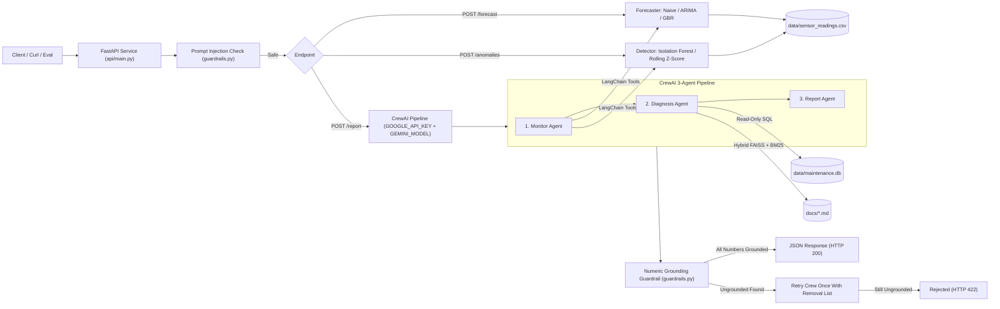

# Industrial Equipment Monitoring Agent

A production-structured **predictive maintenance** system combining time-series forecasting, unsupervised anomaly detection, hybrid RAG (FAISS + BM25), and a 3-agent CrewAI diagnostic pipeline powered by Gemini, served behind a FastAPI REST API with strict input/output guardrails.

> **Important Note on Data**: All sensor telemetry (`data/sensor_readings.csv`) and maintenance history records (`data/maintenance.db`) generated by this project are **SYNTHETIC** (created deterministically with seed `42` in `data/generate_data.py`).

---

## Quick start (one command)

From a fresh clone, one command installs dependencies, checks imports, runs Ruff linting, generates the synthetic data, runs all forecasting & anomaly benchmarks, runs Pytest, and updates the `Results` tables below from `results/*.json` (and runs the 10-case agent evaluation when `GOOGLE_API_KEY` and `GEMINI_MODEL` are set):

```bash
# macOS / Linux (Makefile)
make all

# macOS / Linux (bash script — also runs agent eval if GOOGLE_API_KEY & GEMINI_MODEL are set)
chmod +x run_all.sh
./run_all.sh
```

```powershell
# Windows PowerShell (also runs agent eval if GOOGLE_API_KEY & GEMINI_MODEL are set)
.\run_all.ps1
```

If you have exported `GOOGLE_API_KEY` and `GEMINI_MODEL` and want `make` to include the 10-case CrewAI agent evaluation too:

```bash
make all-with-agents
```

---

## Run in your browser with GitHub Codespaces

You can open and run the entire project in the cloud with zero local Python setup using the included `.devcontainer/devcontainer.json` (Python 3.11 container, automatic `pip install -r requirements.txt` + `python scripts/check_install.py`, and port `8000` forwarded):

1. Open the repository on GitHub and click **Code -> Codespaces -> Create codespace on main**.
2. Wait for the devcontainer build and `postCreateCommand` dependency check to finish.
3. In the Codespaces terminal, run:
   ```bash
   ./run_all.sh
   uvicorn api.main:app --host 0.0.0.0 --port 8000
   ```
4. Open the forwarded **port 8000** URL (or `/docs` for Swagger UI) directly in your browser.

---

## Interactive Browser Dashboard (`app/`)

The `app/` folder contains a standalone **React + TypeScript + Vite + Tailwind + Recharts** web dashboard that re-implements the seeded data generator, walk-forward forecasting, Rolling Z-Score & Isolation Forest anomaly detection, BM25 manual search, guardrails, and live unit tests directly in the browser (plus a lightweight Node proxy for `@google/genai` using `GEMINI_API_KEY`). The Python backend in the repository root remains the full production implementation.

```bash
cd app
npm install
npm run dev
```

Open `http://localhost:3000` (set `GEMINI_API_KEY` in your environment to enable the live Gemini Report step). See `app/README.md` for details.

---

## Project Overview

The system monitors five industrial machines (`M1` through `M5`) across four hourly sensor channels (`temperature`, `vibration`, `pressure`, `rpm`) over a 90-day period (`10,800` total hourly readings):

1. **Synthetic Data & Maintenance Knowledge Base (`data/generate_data.py`, `docs/`)**:
   - Generates multi-sensor time series (slow trend + daily seasonality + Gaussian noise) with ~2% injected anomalies of three types: **sudden spikes**, **gradual drift before failure**, and **flat-line sensor faults**.
   - Populates a SQLite database (`data/maintenance.db`, table `maintenance_logs`) with ~40 realistic maintenance records tied to the anomaly episodes.
   - Provides 4 maintenance-manual markdown documents in `docs/` (`overheating.md`, `bearing_vibration.md`, `pressure_loss.md`, `sensor_faults.md`).
2. **24-Hour Sensor Forecasting (`forecasting/forecaster.py`)**:
   - Evaluates **Naive Last-Value**, **ARIMA** (`statsmodels`), and **Gradient Boosting** (`scikit-learn`) using a strict chronological time-based split (zero leakage).
   - Saves aggregate and per-series MAE/RMSE benchmarks to `results/forecast_metrics.json`.
3. **Anomaly Detection (`anomaly/detector.py`)**:
   - Compares **Isolation Forest** (`scikit-learn`) and a causal **Rolling Z-Score** detector against `is_anomaly` using precision, recall, and F1.
   - Saves evaluation results to `results/anomaly_metrics.json`.
4. **LangChain Tools, Hybrid RAG & CrewAI Agents (`agents/`)**:
   - Wraps `forecast_tool`, `anomaly_tool`, `maintenance_log_tool` (read-only SQLite URI queries), and `rag_tool` (FAISS vector store + `BM25Okapi` combined via Reciprocal Rank Fusion).
   - Reads the embedding model from `GEMINI_EMBEDDING_MODEL` (default `"models/text-embedding-004"`) and automatically falls back to local TF-IDF embeddings on any initialization or query-time error.
   - Orchestrates **Monitor Agent**, **Diagnosis Agent**, and **Report Agent** via CrewAI using `GOOGLE_API_KEY` and `GEMINI_MODEL` (with the `gemini/` prefix added automatically if missing). If `GOOGLE_API_KEY` or `GEMINI_MODEL` is missing, `/forecast` and `/anomalies` remain fully operational while `/report` returns a clear HTTP `503` error.
5. **Guardrails & FastAPI Service (`guardrails.py`, `api/main.py`)**:
   - Blocks prompt-injection and SQL-injection attempts on user input (`HTTP 400`).
   - Verifies every number in the final agent report appears in captured tool outputs. If ungrounded numbers are detected, the crew retries once with an explicit correction listing the numbers to remove; if the retry also fails, it rejects the report (`HTTP 422`).
   - Enforces step limits, execution timeouts (`HTTP 504`), and structured JSON logging.

---

## Architecture



---

## Setup & Run (Local Step-by-Step)

### Prerequisites
- Python **3.11**
- Optional: `GOOGLE_API_KEY`, `GEMINI_MODEL`, and `GEMINI_EMBEDDING_MODEL` environment variables (required only for CrewAI `/report`, Google embeddings, and `evaluation/run_eval.py`; check Google AI Studio for current model names).

### 1. Create Virtual Environment & Install Dependencies
```bash
python3.11 -m venv .venv
source .venv/bin/activate
pip install --upgrade pip
pip install -r requirements.txt
python scripts/check_install.py
```

### 2. Configure Environment Variables
```bash
cp .env.example .env
# Edit .env and set GOOGLE_API_KEY, GEMINI_MODEL, and GEMINI_EMBEDDING_MODEL
export $(grep -v '^#' .env | xargs)
```

### 3. Generate Data, Run Benchmarks, Tests & Update Results Tables
```bash
ruff check .
python -m data.generate_data
python -m forecasting.forecaster
python -m anomaly.detector
pytest -v
python scripts/update_readme.py
```

### 4. Start the FastAPI Server
```bash
uvicorn api.main:app --host 0.0.0.0 --port 8000
```

### 5. Run the 10-Case Agent Evaluation (Requires `GOOGLE_API_KEY` & `GEMINI_MODEL`)
```bash
python -m evaluation.run_eval
python scripts/update_readme.py
```

---

## Setup & Run (Docker)

### Using Docker Compose
```bash
python -m data.generate_data
export GOOGLE_API_KEY="your-google-api-key"
export GEMINI_MODEL="gemini-3.8-flash"
export GEMINI_EMBEDDING_MODEL="models/text-embedding-004"
docker compose up --build
```

The API will be available at `http://localhost:8000` with `./data` and `./results` mounted into `/app/data` and `/app/results`. `.env` is excluded via `.dockerignore` and never copied into the image.

### Using Plain Docker
```bash
docker build -t industrial-equipment-monitoring-agent:latest .
docker run -p 8000:8000 \
  -e GOOGLE_API_KEY="$GOOGLE_API_KEY" \
  -e GEMINI_MODEL="$GEMINI_MODEL" \
  -e GEMINI_EMBEDDING_MODEL="$GEMINI_EMBEDDING_MODEL" \
  -v "$(pwd)/data:/app/data" \
  -v "$(pwd)/results:/app/results" \
  industrial-equipment-monitoring-agent:latest
```

---

## Example API Requests

### Health Check
```bash
curl -s http://localhost:8000/health | jq
```

### 24-Hour Sensor Forecast
```bash
curl -s -X POST http://localhost:8000/forecast \
  -H "Content-Type: application/json" \
  -d '{
    "machine_id": "M1",
    "sensor": "temperature",
    "horizon_hours": 24
  }' | jq
```

### Anomaly Detection
```bash
curl -s -X POST http://localhost:8000/anomalies \
  -H "Content-Type: application/json" \
  -d '{
    "machine_id": "M2",
    "lookback_hours": 500,
    "method": "both"
  }' | jq
```

### AI Agent Diagnosis & Maintenance Report
```bash
curl -s -X POST http://localhost:8000/report \
  -H "Content-Type: application/json" \
  -d '{
    "machine_id": "M1",
    "sensor": "vibration",
    "notes": "Operator noted elevated bearing housing noise during shift change.",
    "lookback_hours": 500,
    "max_steps": 5,
    "timeout_seconds": 60
  }' | jq
```

---

## Results

Run `make all` (or `./run_all.sh` / `python scripts/update_readme.py`) to populate these tables automatically from `results/forecast_metrics.json`, `results/anomaly_metrics.json`, and `results/agent_eval.json`.

### Forecasting Benchmark (`results/forecast_metrics.json`)

Results generated on 2026-11-18 from the files in results/

<!-- RESULTS:FORECAST:START -->
| Model | Mean MAE | Mean RMSE |
| --- | --- | --- |
| Naive Last-Value | 7.3377 | 13.3380 |
| ARIMA (`statsmodels`) | 8.7721 | 14.5404 |
| Gradient Boosting (`scikit-learn`) | 3.3172 | 11.5791 |
<!-- RESULTS:FORECAST:END -->

### Anomaly Detection Benchmark (`results/anomaly_metrics.json`)

<!-- RESULTS:ANOMALY:START -->
| Detector | Precision | Recall | F1 Score |
| --- | --- | --- | --- |
| Isolation Forest | 0.5814 | 0.8197 | 0.6803 |
| Rolling Z-Score | 1.0000 | 0.8852 | 0.9391 |
<!-- RESULTS:ANOMALY:END -->

### Agent Report Evaluation (`results/agent_eval.json`)

<!-- RESULTS:AGENT:START -->
| Metric | Value |
| --- | --- |
| Total Test Cases | requires GOOGLE_API_KEY and GEMINI_MODEL |
| Passed Cases | requires GOOGLE_API_KEY and GEMINI_MODEL |
| Pass Rate (%) | requires GOOGLE_API_KEY and GEMINI_MODEL |
<!-- RESULTS:AGENT:END -->

---

## Limitations

- **Synthetic Data Only**: Both the 90-day hourly sensor telemetry (`data/sensor_readings.csv`) and the ~40 maintenance history records (`data/maintenance.db`) are **synthetic**, generated deterministically from sinusoidal patterns, linear trends, Gaussian noise, and scripted fault injections rather than real industrial PLC/SCADA historians.
- **Simplified Physics & Maintenance Taxonomy**: Real rotating machinery exhibits cross-coupling across operating regimes, ambient conditions, variable load schedules, and multi-stage failure modes not captured by four independent synthetic channels.
- **LLM & API Dependency**: While `/forecast` and `/anomalies` run completely offline, `/report` and `evaluation/run_eval.py` require valid `GOOGLE_API_KEY` and `GEMINI_MODEL` values plus outbound network access to Gemini. Strict numeric grounding can reject an otherwise sensible report if the LLM formats or rounds a number differently from the raw tool output even after one retry.
- **Static Hyperparameters**: ARIMA orders, Gradient Boosting hyperparameters, Isolation Forest contamination, and Rolling Z-Score thresholds are fixed defaults and have not been tuned per asset class.

---

## Publish to GitHub

`.gitignore` excludes `.venv/`, `__pycache__/`, `.env`, `.pytest_cache/`, `.ruff_cache/`, `data/sensor_readings.csv`, and `data/maintenance.db`, while keeping `results/*.json` tracked.

```bash
git init
git add .
git commit -m "Initial commit: Industrial Equipment Monitoring Agent"
git branch -M main
git remote add origin https://github.com/<your-username>/industrial-equipment-monitoring-agent.git
git push -u origin main
```
